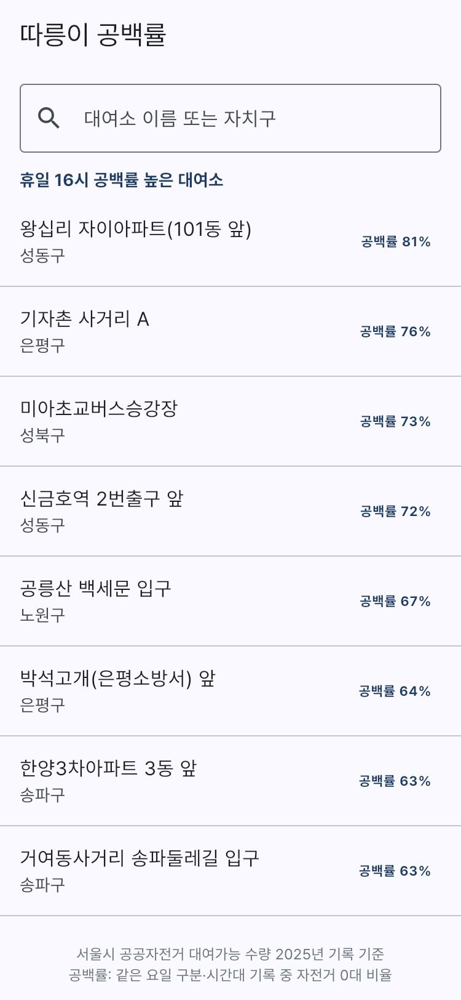
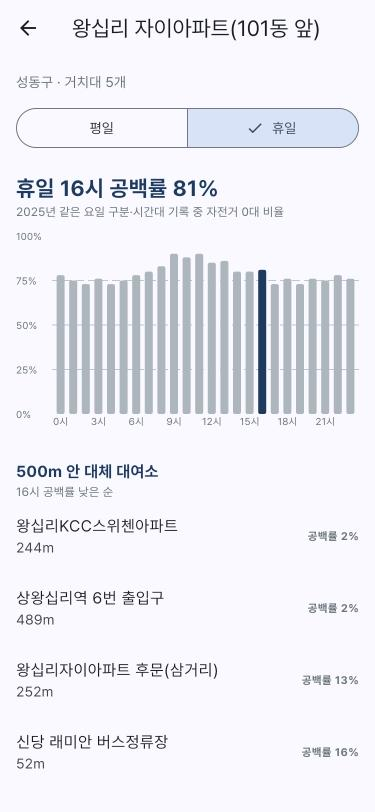

# 따릉이 대여소 공백률

서울시 공공자전거 따릉이 대여소별 **시간대 공백률**(자전거 0대 비율) 산출과 대체 대여소 안내 앱.
2025년 1년 기록 2,418만 행 기반.

<p>
  
  &nbsp;
  
</p>

---

## 문제 정의
- 대여소 도착 후 자전거 없음 확인 시 다른 대여소 재탐색 필요
- 따릉이 앱의 현재 대수 정보만으로는 도착 시점 상황 예측 곤란
- 운영 측: 시간대별로 자주 비는 대여소 파악 필요

## 목표
- 대여소·요일 구분(평일/휴일)·시간대별 공백률 산출
- 대여소 검색 시 시간대별 공백률, 반경 500m 대체 대여소 안내 앱
- 운영 점검이 필요한 대여소 목록 도출

**공백률** = 해당 대여소·요일 구분·시간대의 "자전거 0대" 기록 수 ÷ 전체 기록 수

---

## 처리 흐름

| 단계 | 내용 | 도구 | 파일 |
|---|---|---|---|
| 수집 | 서울 열린데이터광장 파일 내려받기, 새 파일만 추가 수집 | Python · urllib | `scripts/fetch.py` |
| 점검 | 인코딩·칼럼·중복·누락·이상값 확인 | Python · pandas | `scripts/check_files.py`, `analysis/data_quality.md` |
| 저장 | CP949 CSV 12개 → DuckDB 적재 | DuckDB | `scripts/load.py` |
| 정제·집계 | 운영 판단 기준 적용, 공백률 표, 앱용 JSON | DuckDB SQL | `scripts/build_metrics.py` |
| 분석 | 시간대·자치구·월별 공백률, 대체 대여소, 운영 점검 대상 | DuckDB SQL | `analysis/queries.sql`, `analysis/query_results.md` |
| 서비스 | 대여소 검색·시간대별 공백률·대체 대여소 | Flutter · fl_chart | `app/` |

## 데이터

| 데이터 | 출처 | 형식 |
|---|---|---|
| 대여소별 대여가능 수량 (1시간 단위) | [서울 열린데이터광장 OA-22382](https://data.seoul.go.kr/dataList/OA-22382/F/1/datasetView.do) | 분기별 zip, 월별 CSV (CP949), 2025년 4개 분기 약 382MB |
| 대여소 정보 (위치·거치대 수) | [서울 열린데이터광장 OA-13252](https://data.seoul.go.kr/dataList/OA-13252/F/1/datasetView.do) | xlsx, 2025년 12월 기준 |

- 수량 파일 칼럼: `일시, 대여소번호, 대여소명, 시간대, 거치대수량`
- 칼럼명 "거치대수량"의 실제 값: 시간대별 주차 자전거 수 (예: 거치대 15개 대여소에서 하루 44대~8대 변동) → `bikes`로 변경
- 공개 시기 수시 (2025년 파일 2026년 6월 공개) → `fetch.py` 월 1회 실행으로 새 파일만 수집

---

## 데이터 점검과 처리

| 점검 항목 | 값 | 처리 |
|---|---|---|
| 전체 기록 | 24,188,026 | |
| 중복·음수 | 0 | 없음 |
| 24시간 중 빠진 시간이 있는 대여소·날짜 | 17,149 | 보간 없이 존재하는 기록만 사용 (6개 날짜는 전 대여소 공통 1시간 누락) |
| 1년 내내 0대인 대여소 | 22 | 제외 |
| 운영 기간(처음~마지막 자전거 기록) 밖 기록 | 122,973 | 개설 전·폐쇄 후로 보고 제외 |
| 자전거가 있던 날 10일 미만인 대여소·월 | 508 | 장기 운영 중단으로 보고 그달 제외 |
| 대여소 정보에 없는 대여소 번호 | 36 | 위치 정보 없음, 앱 제외 |
| 자전거 수 > 거치대 수 × 3 | 1,402,625 (5.8%) | 거치대 수 기준 "만차" 판단 불가 → 지표는 공백(0대)만 사용 |

### 운영 판단 기준 수정
1. 초기 기준 "한 달 내내 0대인 달 제외" 적용 시 휴일 16시 공백률 100% 대여소 4곳이 상위 노출
2. 원인: 1년 중 362일 내내 0대, 12월 1회 1대 기록 → 단 1회 기록으로 "운영 중" 판정 (신림역 5번출구)
3. "자전거 있던 날 3일 미만 제외"도 한 달 2~4일 기록 대여소를 거르지 못함
4. 실제로 자주 비는 대여소의 최소치(미아초교버스승강장, 가장 적은 달 13일) 확인 후 **월 10일 미만 제외 + 운영 기간 한정**으로 확정
5. 결과: 100% 이상값 제거, 최고 공백률 88% (미아초교버스승강장, 평일 8시)

---

## 분석 결과 (2025년)

| 항목 | 결과 |
|---|---|
| 평일 시간대별 공백률 | 10시 최고 12.1%, 17~18시 최저 8.4% |
| 휴일 시간대별 공백률 | 7.2~9.5%, 평일보다 낮음 |
| 자치구별 평일 출근 시간(7~9시) | 은평구 17.9% 최고, 구로구·중랑구 5.1% 최저 |
| 평일 출근 시간 공백률 1위 | 미아초교버스승강장(성북구) 87.5% |
| 월별 공백률 | 9월 11.3% 최고, 11월 7.8% 최저 |
| 대체 대여소 | 평일 8시 공백률 50% 이상 89곳 중 42곳(47%): 500m 안에 공백률 10% 미만 대여소 존재 |
| 운영 점검 대상 | 대여소 정보에 등록, 2025년 자전거 있던 날 10일 미만 24곳 (거치대 371개), 그중 17곳 1년 내내 0대. 원인은 이 데이터로 확인 불가 |

전체 결과: [`analysis/query_results.md`](analysis/query_results.md)

## DB 선택: SQLite와 DuckDB

같은 데이터·같은 단계·같은 PC 측정.

| 단계 | SQLite | DuckDB |
|---|---|---|
| 적재 (CSV 12개) | 151초 | 47초 |
| 정제·집계 | 592초 | 7초 |
| DB 파일 크기 | 1,130MB | 77MB |
| 월별 공백률 쿼리 (전체 행 집계) | 222초 | 0.52초 |

- 두 DB 모두 서버 없는 파일 DB, 결과값 동일
- SQLite: 행 단위 저장, 건별 입출력 위주 서비스에 적합
- DuckDB: 열 단위 저장·압축, 수천만 행 집계에 적합 → 분석 중심인 이 프로젝트에 선택
- 앱에는 원본 대신 집계 결과 JSON(약 750KB)만 포함 → 앱 실행에 서버·DB 불필요

---

## 앱 (Flutter)

| 화면 | 기능 |
|---|---|
| 검색 | 검색어 없을 때 현재 시간 공백률 높은 대여소 20곳, 대여소 이름·자치구 검색 |
| 상세 | 평일/휴일 선택, 24시간 공백률 막대그래프(현재 시각 강조), 500m 안 대체 대여소(공백률 낮은 순) |

- 거리: 서울 위도 기준 근사 (경도 1도 약 88.2km, 위도 1도 약 111km)
- 요일 구분: 앱 기본값은 토·일 휴일 (공휴일은 화면에서 휴일 선택)
- 글꼴: Pretendard 1.3.9 앱 포함 (SIL OFL 1.1, `app/fonts/LICENSE.txt`)

---

## 실행 방법

| 도구 | 버전 |
|---|---|
| Python | 3.10 |
| pandas · openpyxl · duckdb | 2.3.3 · 3.1.5 · 1.5.6 |
| Flutter | 3.47.7 stable (Dart 3.13.5) |
| fl_chart | 1.2.0 |

```
python -m venv .venv
.venv\Scripts\python -m pip install -r requirements.txt
.venv\Scripts\python -I scripts\fetch.py           # 원본 내려받기 (약 382MB)
.venv\Scripts\python -I scripts\load.py            # DuckDB 적재
.venv\Scripts\python -I scripts\build_metrics.py   # 정제·집계·앱용 JSON
.venv\Scripts\python -I scripts\run_queries.py     # 분석 결과 표

cd app
flutter pub get
flutter test
flutter run -d edge
```

원본 데이터·DB 파일은 저장소에서 제외 (`fetch.py` → `load.py`로 재생성). 앱용 JSON은 포함되어 있어 앱은 바로 실행 가능.

## 폴더 구조
```
scripts/    수집·점검·적재·정제·분석 실행
analysis/   점검 결과, 분석 쿼리·결과, DB 비교
app/        Flutter 앱 (lib, assets, fonts, test)
data/       원본·DB (저장소 제외)
```

## 한계와 향후 계획
- 2025년 기록 기반 경향값, 실시간 대수 아님 → 서울시 실시간 대여정보 API([OA-15493](https://data.seoul.go.kr/dataList/OA-15493/A/1/datasetView.do)) 연동 시 현재 대수 함께 표시 가능 (서버 필요)
- 거치대 수보다 많은 자전거 기록 다수 → 반납 가능 여부(만차) 지표 미제공
- 운영 점검 대상 대여소의 미운영 원인 미확인
- 앱 공휴일 자동 판별 미지원
