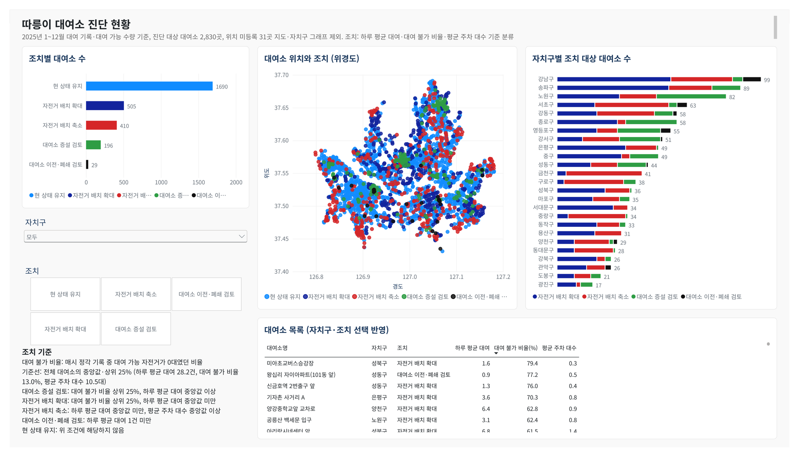
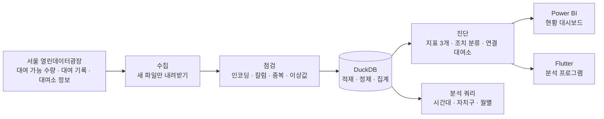

# 서울 공공자전거 대여소 진단 프로그램

서울시 공공자전거 대여 기록과 대여 가능 수량 기반 대여소별 수요·공급 상태 진단, 대여소마다 검토할 운영 조치 분류.



*Power BI 현황 대시보드. 조치별 대여소 수, 대여소 위치, 자치구별 조치 대상, 대여소 목록.*

---

## 개요

| 항목 | 내용 |
|---|---|
| 형태 | 개인 프로젝트 |
| 목적 | 자주 비는 대여소와 자전거가 남는 대여소를 운영 기록으로 구분하고, 대여소마다 검토할 조치 제시 |
| 데이터 | 서울 열린데이터광장 대여 가능 수량, 대여 기록, 대여소 정보 |
| 결과물 | 수집·정제·진단 스크립트와 SQL, Power BI 현황 대시보드, Flutter 분석 프로그램 |

## 기술 스택과 선택 이유

| 역할 | 기술·버전 | 선택 이유 | 대안과 비교 |
|---|---|---|---|
| 언어 | Python 3.10 | DuckDB 1.5·numpy 2.2가 요구하는 최소 버전 | 3.8 이하는 두 라이브러리 미지원 |
| 집계 DB | DuckDB 1.5 | 열 단위 저장이라 필요한 칼럼만 읽어 집계. 판별 기준을 바꿀 때마다 다시 집계하는 작업에 적합 | SQLite는 행 단위 저장이라 집계 때 모든 칼럼을 읽음. 같은 단계로 비교해 결과값 일치 확인 |
| 표 처리 | pandas 2.3 | 파일 점검과 내보내기를 표 단위로 처리해 반복 코드 감소 | csv 모듈은 행마다 반복문 작성 |
| 대시보드 | Power BI Desktop | 항목 선택 시 그래프와 목록이 함께 걸러지는 화면을 코드 없이 구성 | 그래프 코드 작성은 필터 연동을 따로 구현 |
| 분석 프로그램 | Flutter 3.47 stable | 코드 한 벌로 웹·데스크톱·휴대폰 화면 구성, pubspec 고정으로 같은 환경 재현 | PyQt는 데스크톱 전용, React는 웹 전용 |

---

## 전체 구조



| 단계 | 내용 | 파일 |
|---|---|---|
| 수집 | 사이트 파일 목록과 보유 파일 대조, 새 파일만 내려받기 | `scripts/fetch.py` |
| 점검 | 인코딩·칼럼·중복·누락·이상값 확인 | `scripts/check_files.py`, `analysis/data_quality.md` |
| 적재 | 대여 가능 수량 적재, 대여 기록을 대여소·시간대별 대여·반납 수로 집계 | `scripts/load.py`, `scripts/load_rentals.py` |
| 정제·집계 | 운영 판별 기준 적용, 전량 대여 비율 표, 앱용 JSON | `scripts/build_metrics.py` |
| 진단 | 지표 산출, 기준선 계산, 조치 분류, 상·하반기 검증, 연결 대여소 | `scripts/build_diagnosis.py` |
| 방식 비교 | 규칙 기반 분류와 k-means 군집화 비교 | `scripts/compare_methods.py` |
| 분석 쿼리 | 시간대·자치구·월별 전량 대여 비율, 운영 점검 대상 | `analysis/queries.sql`, `scripts/run_queries.py` |
| 내보내기 | Power BI용 CSV | `scripts/export_powerbi.py` |

---

## 1. 데이터 수집과 점검

| 데이터 | 출처 | 형식 |
|---|---|---|
| 대여 가능 수량, 1시간 단위 | [서울 열린데이터광장 OA-22382](https://data.seoul.go.kr/dataList/OA-22382/F/1/datasetView.do) | 분기별 zip, 월별 CSV, CP949 |
| 대여 기록 | [서울 열린데이터광장 OA-15182](https://data.seoul.go.kr/dataList/OA-15182/F/1/datasetView.do) | 연 단위 zip, 월별 CSV, CP949 |
| 대여소 정보, 위치·자치구·거치대 수 | [서울 열린데이터광장 OA-13252](https://data.seoul.go.kr/dataList/OA-13252/F/1/datasetView.do) | xlsx, 2025년 12월 기준 |

- 수집: 실행할 때마다 사이트의 파일 목록과 보유 파일을 대조해 없는 파일만 내려받기. Python 표준 라이브러리 `urllib`만 사용
- 칼럼 의미 확인: 대여 가능 수량 파일의 "거치대수량" 칼럼 값이 같은 대여소에서도 시간마다 크게 달라짐을 확인, 실제 뜻인 시간대별 거치 자전거 수에 맞춰 `bikes`로 변경

| 점검 항목 | 처리 |
|---|---|
| 중복·음수 | 없음 확인 |
| 24시간 중 빠진 시간이 있는 대여소·날짜 | 보간 없이 있는 기록만 사용 |
| 1년 내내 0대인 대여소 | 제외 |
| 첫·마지막 자전거 기록 밖 기간 | 개설 전·폐쇄 후 기록으로 보고 제외 |
| 자전거가 있던 날이 월 10일 미만인 달 | 운영 중단으로 보고 그달 제외 |
| 대여소 정보에 없는 대여소 번호 | 위치 정보가 없어 지도·연결 대여소·앱에서 제외 |
| 자전거 수가 거치대 수의 3배를 넘는 기록 | 거치대 수로 만차 판단이 안 되므로 0대 기록 기준 전량 대여 비율만 사용 |

## 2. 지표와 조치 분류

| 지표 | 정의 |
|---|---|
| 하루 평균 대여 | 대여 건수 ÷ 운영일 |
| 전량 대여 비율 | 시간대별 기록 중 대여 가능 자전거 0대 기록 ÷ 전체 기록 |
| 평균 거치 자전거 수 | 시간대별 거치 자전거 수 평균 |

| 조치 | 조건 |
|---|---|
| 대여소 증설 검토 | 하루 평균 대여 중앙값 이상, 전량 대여 비율 상위 25% |
| 자전거 배치 확대 | 하루 평균 대여 중앙값 미만, 전량 대여 비율 상위 25% |
| 자전거 배치 축소 | 하루 평균 대여 중앙값 미만, 전량 대여 비율 상위 25% 밖, 평균 거치 자전거 수 중앙값 이상 |
| 대여소 이전·폐쇄 검토 | 하루 평균 대여 1건 미만 또는 운영 기록 없음 |
| 현 상태 유지 | 그 외 |

- 기준선: 고정값 대신 대여소 분포의 중앙값·상위 25% 경계에서 산출. 데이터를 다시 받으면 기준선도 다시 계산
- 연결 대여소: 증설·배치 확대 대상마다 반경 1km 안의 배치 축소 대상을 거리순으로 연결
- 검증: 상반기와 하반기를 따로 분류해 같은 대여소의 분류가 유지되는지 확인

### 분류 방식 선택

같은 지표 3개로 규칙 기반 분류와 k-means 군집화를 비교한 뒤 규칙 기반 채택. k-means는 numpy로 구현하고 초기값 10가지로 반복 실행.

| 항목 | 규칙 기반 | k-means 군집화 |
|---|---|---|
| 상·하반기 분류 일치율 | 79.6% | 평균 75.3% |
| 같은 데이터 재실행 | 항상 같은 결과 | 초기값에 따라 결과 변동 |
| 많이 쓰는데 자주 비는 대여소 | 별도 분류로 구분 | 따로 묶이지 않음 |
| 조치 연결 | 분류 이름이 곧 조치 | 묶음마다 해석 후 조치 지정 |

수요 예측 모델은 쓰지 않음. 목적이 미래 수요 예측이 아닌 2025년 운영 기록 기반 현황 분류이기 때문.

## 3. SQL 분석

| SQL 기법 | 사용 위치 |
|---|---|
| 집계 함수 `median`, `quantile_cont` | 대여소 분포에서 중앙값·상위 25% 경계 산출 |
| `CASE` | 기준선과 비교해 조치 분류 |
| `WITH` 공통 테이블 식 | 운영 기간 기록만 걸러 낸 뒤 다음 단계에서 재사용 |
| 윈도 함수 `row_number() OVER (PARTITION BY ...)` | 대여소마다 가까운 연결 대여소 순위 부여 |
| 기록 수 가중 평균 | 여러 대여소를 합칠 때 기록 수가 다른 대여소의 비율을 공정하게 합산 |
| 정렬 기준 고정 | 반올림 전 값으로 정렬하고 동률이면 대여소 번호순, 여러 번 실행해도 같은 순위 |

분석 결과 요약: 하루 평균 대여가 적은 대여소일수록 전량 대여 비율이 높음, 평일에는 오전 10시에 가장 높고 17~18시에 가장 낮음. 세부 결과는 `analysis/query_results.md`.

## 4. Power BI 현황 대시보드

| 구성 | 내용 |
|---|---|
| 데이터 | `export_powerbi.py`가 만든 CSV, 다시 집계한 뒤 새로 고침하면 갱신 |
| 화면 | 조치별 대여소 수, 위경도 산점도, 자치구별 조치 대상, 전량 대여 비율 높은 순 대여소 목록 |
| 연동 | 자치구·조치 선택 시 그래프와 목록 함께 필터 |
| DAX | `조치 대상 수 = CALCULATE([대여소 수], KEEPFILTERS(stations[조치] <> "현 상태 유지"))` |

## 5. Flutter 분석 프로그램

운영 담당자가 대여소별 추천 조치와 근거를 확인하는 화면. Flutter 웹 빌드로 실행.

| 메뉴 | 화면 |
|---|---|
| 현황 | 추천 조치별 대여소 수와 추천 기준, 자치구별 추천 대여소 수 |
| 분석 | 대여소 위치별 추천 조치 분포, 자치구 선택 시 범위 확대와 조치 구성 비율 |
| 조치 추천 | 조치별 추천 대여소 목록, 자치구·정렬 기준 선택 |
| 대여소 조회 | 전체 대여소 검색, 자치구·추천 조치 선택 |
| 대여소 상세 | 추천 조치와 근거, 지표 3개의 기준선 비교, 시간대별 전량 대여 비율, 반경 1km 연결 대여소 |

- 화면 코드와 판정 코드 분리: 화면은 `*_page.dart`, 대여소 데이터는 `data.dart`, 추천 조치·근거·연결 대여소 판정은 `diagnosis.dart`
- 단위 시험 `app/test/diagnosis_test.dart`: 거리 계산, 검색, 목록 정렬, 추천 근거, 추천 기준 문장, 연결 대여소
- 추천 조치는 참고용이고 최종 결정은 운영 담당자 몫

---

## 문제 해결

| 현상 | 원인 | 해결 |
|---|---|---|
| 휴일 오후에 전량 대여 비율 100%인 대여소가 상위에 노출 | "한 달 내내 0대인 달 제외" 기준으로는 1년 중 자전거가 한 번만 있던 대여소도 운영 중으로 판정 | 실제로 자주 비는 대여소의 한 달 최소 보유일을 확인한 뒤 "자전거가 있던 날 월 10일 미만인 달 제외, 운영 기간 안 기록만 사용"으로 기준 확정 |
| 칼럼 이름과 값의 뜻 불일치 | "거치대수량" 칼럼 값이 거치대 개수가 아닌 시간대별 거치 자전거 수 | 하루 사이 값 변동을 확인해 칼럼 이름을 `bikes`로 변경 |
| 거치대 수로 만차 여부를 판단할 수 없음 | 자전거 수가 거치대 수의 3배를 넘는 기록 존재 | 만차 판단은 빼고 0대 기록 기준 전량 대여 비율만 사용 |
| 분석 쿼리 순위가 실행마다 달라짐 | 반올림한 값으로 정렬해 동률 순서가 정해지지 않음 | 반올림 전 값으로 정렬하고 동률이면 대여소 번호순 |

## 한계와 개선 방향

| 설계 선택 | 한계 | 개선 방향 |
|---|---|---|
| 2025년 기록 기반 분류 | 실시간 상황 미반영 | 실시간 대여 현황 API 연동 |
| 0대 기록 기준 전량 대여 판단 | 거치대 대비 과밀 정도 미측정 | 실제 수용 한도 자료 확보 후 만차 지표 추가 |
| 중앙값·상위 25% 기준선 | 경계 부근 대여소는 기간에 따라 분류 변동 | 경계 구간을 별도 표시 |
| 연결 대여소: 반경 1km 직선거리 | 실제 이동 경로·시간 미반영 | 도로 경로 거리로 교체 |
| 조치 추천 | 조치 후 효과 미검증 | 조치 전후 기록 비교 |

---

## 실행 방법

| 도구 | 버전 |
|---|---|
| Python | 3.10 |
| pandas · openpyxl · duckdb | 2.3.3 · 3.1.5 · 1.5.6 |
| Flutter | 3.47.7 stable, Dart 3.13.5 |
| Power BI Desktop | 2.159 |

```
python -m venv .venv
.venv\Scripts\python -m pip install -r requirements.txt
.venv\Scripts\python -I scripts\fetch.py             # 원본 내려받기
.venv\Scripts\python -I scripts\load.py              # 대여 가능 수량 DuckDB 적재
.venv\Scripts\python -I scripts\build_metrics.py     # 정제·집계·앱용 JSON
.venv\Scripts\python -I scripts\load_rentals.py      # 대여 기록 → 대여소·시간대별 대여·반납 수
.venv\Scripts\python -I scripts\build_diagnosis.py   # 조치 분류·검증·연결 대여소
.venv\Scripts\python -I scripts\compare_methods.py   # 규칙 기반 · k-means 비교
.venv\Scripts\python -I scripts\run_queries.py       # 분석 쿼리 결과 표
.venv\Scripts\python -I scripts\export_powerbi.py    # Power BI용 CSV

cd app
flutter pub get
flutter test
```

원본 데이터와 DB 파일은 저장소에서 제외, `fetch.py`부터 다시 실행해 생성. 앱용 JSON과 Power BI용 CSV는 포함.

## 폴더 구성

```
scripts/    수집·점검·적재·정제·진단·분석·내보내기
analysis/   점검 결과, 진단 요약, 방식 비교, 분석 쿼리·결과, DB 비교
powerbi/    Power BI 보고서·테마, 데이터 CSV
app/        Flutter 분석 프로그램
data/       원본·DB, 저장소 제외
```
