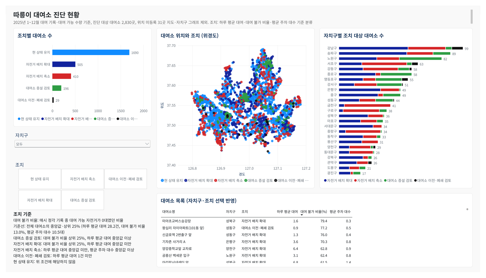

# 따릉이 대여 기록 기반 대여소 진단 프로그램

서울시 공공자전거 따릉이 2025년 **대여 가능 수량 2,418만 행 · 대여 기록 3,737만 건**으로 대여소별 수요와 공급 상태를 측정하고,
운영자가 검토할 조치(대여소 증설 검토 · 자전거 배치 확대 · 자전거 배치 축소 · 대여소 이전·폐쇄 검토)를 대여소마다 분류하는 프로젝트.



Power BI 현황 대시보드 (`powerbi/따릉이_대여소_진단.pbix`)

---

## 문제 정의
- 대여소별 수요·공급 불균형: 자주 비는 곳과 자전거가 남는 곳 공존
- 판단 근거 분산: 대여 가능 수량·대여 기록·대여소 위치 별도 공개
- 증설·재배치·점검 대상 선정 근거 필요

## 목표
- 수요 × 대여 불가 비율 기준 대여소별 조치 분류
- 자주 비는 대여소별 1km 안 재배치 상대 대여소 제시
- 운영자용 Power BI 현황 대시보드, Flutter 데스크톱 진단 도구

## 지표 정의 (2025년 운영 기간 기록 기준)

| 지표 | 정의 |
|---|---|
| 하루 평균 대여 | 대여 건수 ÷ 운영일 |
| 대여 불가 비율 | 매시 정각 기록 중 대여 가능 자전거 0대 기록 ÷ 전체 기록 |
| 평균 주차 대수 | 시간대별 주차 자전거 수 평균 |

코드·분석 파일의 `empty_rate`(공백률)가 대여 불가 비율.

---

## 처리 흐름

| 단계 | 내용 | 도구 | 파일 |
|---|---|---|---|
| 수집 | 서울 열린데이터광장 파일 목록 비교, 새 파일만 내려받기 | Python · urllib | `scripts/fetch.py` |
| 점검 | 인코딩·칼럼·중복·누락·이상값 확인 | Python · pandas | `scripts/check_files.py`, `analysis/data_quality.md` |
| 적재 | 대여 가능 수량 CSV 12개, 대여 기록 → 대여소·시간대별 대여·반납 수 | DuckDB | `scripts/load.py`, `scripts/load_rentals.py` |
| 정제·집계 | 운영 판별 기준 적용, 대여 불가 비율 표, 앱용 JSON | DuckDB SQL | `scripts/build_metrics.py` |
| 진단 | 지표 3개, 기준선 산출, 조치 분류, 상·하반기 검증, 재배치 상대 | DuckDB SQL | `scripts/build_diagnosis.py`, `analysis/diagnosis_summary.md` |
| 방식 비교 | 규칙 기반 · 군집화(k-means) 비교 | numpy | `scripts/compare_methods.py`, `analysis/method_compare.md` |
| 분석 쿼리 | 시간대·자치구·월별 대여 불가 비율, 운영 점검 대상 | DuckDB SQL | `analysis/queries.sql`, `scripts/run_queries.py` |
| 대시보드 | 분류 결과 CSV 내보내기, Power BI 보고서 | Power BI · DAX | `scripts/export_powerbi.py`, `powerbi/` |
| 진단 도구 | Windows 데스크톱 앱 (작업 중) | Flutter | `app/` |

## 데이터

| 데이터 | 출처 | 형식 |
|---|---|---|
| 대여 가능 수량 (1시간 단위) | [서울 열린데이터광장 OA-22382](https://data.seoul.go.kr/dataList/OA-22382/F/1/datasetView.do) | 분기별 zip 4개, 월별 CSV 12개 (CP949), 약 382MB |
| 대여 기록 | [서울 열린데이터광장 OA-15182](https://data.seoul.go.kr/dataList/OA-15182/F/1/datasetView.do) | 연 zip 1개 1.78GB, 월별 CSV 12개 (CP949), 3,737만 건 |
| 대여소 정보 (위치·자치구·거치대 수) | [서울 열린데이터광장 OA-13252](https://data.seoul.go.kr/dataList/OA-13252/F/1/datasetView.do) | xlsx, 2025년 12월 기준 |

- 수량 파일 칼럼 "거치대수량"의 실제 값: 시간대별 주차 자전거 수 (102번 대여소: 거치대 15개, 2025년 4월 24일 하루 58대~10대 변동) → `bikes`로 변경
- 공개 시기 부정기 (2025년 파일 2026년 6월 공개) → `fetch.py` 월 1회 실행으로 새 파일만 수집

---

## 데이터 점검과 처리

| 점검 항목 | 값 | 처리 |
|---|---|---|
| 전체 기록 | 24,188,026 | |
| 중복·음수 | 0 | 처리 불필요 |
| 24시간 중 빠진 시간이 있는 대여소·날짜 | 17,149 | 보간 없이 실측 기록만 사용 (6개 날짜는 전 대여소 공통 1시간 누락) |
| 1년 내내 0대인 대여소 | 22 | 제외 |
| 운영 기간(첫·마지막 자전거 기록) 밖 기록 | 122,973 | 개설 전·폐쇄 후 기록으로 보고 제외 |
| 자전거가 있던 날 10일 미만인 대여소·월 | 508 | 운영 중단으로 보고 그달 제외 |
| 대여소 정보에 없는 대여소 번호 | 36 | 위치 정보 없음, 지도·재배치 상대·앱 제외 |
| 자전거 수 > 거치대 수 × 3 | 1,402,625 (5.8%) | 거치대 수 기준 만차 판단 불가 → 0대 기록 기준 대여 불가 비율만 사용 |

### 미운영 대여소 판별 기준 수정
1. 초기 기준 "한 달 내내 0대인 달 제외" 적용 시 휴일 16시 대여 불가 비율 100% 대여소 4곳 상위 노출
2. 원인: 신림역 5번출구, 363일 기록 중 자전거 보유 기록 1회(12월 15일 21시, 1대) → 단 1회 기록으로 운영 판정
3. "보유일 3일 미만 달 제외"도 한 달 3~4일 보유 대여소를 거르지 못함
4. 실제로 자주 비는 대여소의 최소 보유일(미아초교버스승강장, 13일) 확인 후 **월 10일 미만 제외 + 운영 기간 한정**으로 확정
5. 결과: 대여 불가 비율 100% 대여소·시간대 0곳, 최고치 89.8% (왕십리 자이아파트(101동 앞) 휴일 11시, 기록 59일)

---

## 분류 기준과 결과

기준선은 고정값 대신 대여소 분포에서 산출 (하루 평균 대여 1건 이상 대여소 기준, 데이터 갱신 시 자동 재산출).

| 조치 (코드 분류) | 조건 | 대여소 |
|---|---|---|
| 대여소 증설 검토 (공급 부족) | 하루 평균 대여 28.2건 이상 + 대여 불가 비율 13.0% 이상 | 196 |
| 자전거 배치 확대 (배치 부족) | 하루 평균 대여 28.2건 미만 + 대여 불가 비율 13.0% 이상 | 505 |
| 자전거 배치 축소 (과잉) | 28.2건 미만 + 대여 불가 비율 13.0% 미만 + 평균 주차 대수 10.5대 이상 | 410 |
| 대여소 이전·폐쇄 검토 (저이용) | 하루 평균 대여 1건 미만 또는 운영 기록 없음 | 29 |
| 현 상태 유지 (적정) | 그 외 | 1,690 |

진단 대상 2,830곳. 28.2건: 하루 평균 대여 중앙값, 13.0%: 대여 불가 비율 상위 25% 경계, 10.5대: 평균 주차 대수 중앙값.

### 분류 방식 선택 (`analysis/method_compare.md`)

같은 지표 3개, 상·하반기 모두 저이용이 아닌 대여소 2,733곳 비교.

| 항목 | 규칙 기반 | 군집화 k-means (k=4, 초기값 10가지) |
|---|---|---|
| 상·하반기 분류 일치율 | 79.6% | 평균 73.0% (54.2~75.9%) |
| 같은 데이터 재실행 | 항상 같음 | 초기값에 따라 일치율 66.7~100% |
| 증설 대상(많이 쓰는데 자주 빔) 묶음 | 196곳 | 없음 |
| 조치 연결 | 분류 이름이 곧 조치 | 묶음 해석 후 지정 |

수요 예측 머신러닝은 단기 재배치용이라 구조적 조치(증설·이전) 판단과 목적 차이로 제외.

---

## 분석 결과

| 항목 | 결과 |
|---|---|
| 수요와 대여 불가 | 하루 평균 대여 하위 25% 대여소 대여 불가 비율 15.8%, 상위 25% 5.9% |
| 대여소 증설 검토 | 196곳, 평균 하루 55.5건 · 대여 불가 비율 18.9% |
| 재배치 상대 | 증설·배치 확대 대상 701곳 중 375곳: 1km 안 자전거 배치 축소 대상 존재 |
| 이전·폐쇄 검토 | 29곳 (거치대 395개), 그중 24곳 운영 기록 없음 |
| 조치 대상 많은 자치구 | 강남 99곳 · 송파 89곳 · 노원 82곳 (현 상태 유지 제외, 위치 등록 1,126곳 기준) |

### 대여 불가 비율 기초 분석 (`analysis/query_results.md`)

| 항목 | 결과 |
|---|---|
| 평일 시간대별 | 10시 최고 12.1%, 17~18시 최저 8.4% |
| 자치구별 평일 출근 시간(7~9시) | 은평구 17.9% 최고, 금천·구로·중랑 5.1% 최저 |
| 평일 출근 시간 1위 대여소 | 미아초교버스승강장(성북구) 87.5% |
| 월별 | 9월 11.3% 최고, 11월 7.8% 최저 |
| 운영 점검 대상 | 대여소 정보에 등록, 2025년 자전거 있던 날 10일 미만 24곳 (거치대 371개), 그중 17곳 1년 내내 0대 |

- 쿼리 2·3 정렬: 반올림 전 값 기준, 동률 시 대여소 번호·자치구명 순 → 5회 연속 실행 결과 일치 (실행 시간 표기 제외)

## DB 선택: SQLite와 DuckDB (`analysis/db_compare.md`)

같은 데이터·같은 단계·같은 PC 측정.

| 단계 | SQLite | DuckDB |
|---|---|---|
| 적재 (CSV 12개) | 151초 | 47초 |
| 정제·집계 | 592초 | 7초 |
| DB 파일 크기 | 1,130MB | 77MB |
| 월별 대여 불가 비율 쿼리 (전체 행 집계) | 222초 | 0.52초 |

- 두 DB 모두 서버 없는 파일 DB, 결과값 동일
- DuckDB: 열 단위 저장·압축, 수천만 행 집계에 적합 → 판별 기준 변경 시마다 재집계하는 이 프로젝트에 선택

---

## Power BI 현황 대시보드 (`powerbi/`)

| 구성 | 내용 |
|---|---|
| 데이터 | `export_powerbi.py` 산출 CSV (`powerbi/data/`), 재집계 후 새로 고침 시 갱신 |
| 화면 | 조치별 대여소 수, 위경도 산점도, 자치구별 조치 대상, 대여소 목록 (대여 불가 비율 높은 순) |
| 연동 | 자치구·조치 선택 시 그래프·목록 함께 필터 |
| DAX | `조치 대상 수 = CALCULATE([대여소 수], KEEPFILTERS(stations[조치] <> "현 상태 유지"))` |
| 테마 | `theme_ddareungi.json` (Pretendard 글꼴) |

위치 미등록 31곳은 산점도·자치구 그래프에서 제외.

## 앱 (Flutter, 작업 중)

- 실행 화면: Windows 데스크톱 진단 도구 (`app/lib/desktop_shell.dart`)
- 대여소 조회 화면 (`search_page.dart` · `detail_page.dart`): 띄어쓰기 무시·대여소 번호 검색, 기록 30일 미만 대여소 상위 목록 제외·참고용 표기, 1분 주기 현재 시각 갱신
- 단위 시험 4개 (`app/test/data_test.dart`): 근사 거리, 요일 구분, 검색, 상위 목록
- 거리: 서울 위도 기준 근사 (경도 1도 약 88.2km, 위도 1도 약 111km)
- 글꼴: Pretendard 1.3.9 앱 포함 (SIL OFL 1.1, `app/fonts/LICENSE.txt`)

---

## 실행 방법

| 도구 | 버전 |
|---|---|
| Python | 3.10 |
| pandas · openpyxl · duckdb | 2.3.3 · 3.1.5 · 1.5.6 |
| Flutter | 3.47.7 stable (Dart 3.13.5) |
| Power BI Desktop | 2.159 |

```
python -m venv .venv
.venv\Scripts\python -m pip install -r requirements.txt
.venv\Scripts\python -I scripts\fetch.py             # 원본 내려받기 (약 2.2GB)
.venv\Scripts\python -I scripts\load.py              # 대여 가능 수량 DuckDB 적재
.venv\Scripts\python -I scripts\build_metrics.py     # 정제·집계·앱용 JSON
.venv\Scripts\python -I scripts\load_rentals.py      # 대여 기록 → 대여소·시간대별 대여·반납 수
.venv\Scripts\python -I scripts\build_diagnosis.py   # 조치 분류·검증·재배치 상대
.venv\Scripts\python -I scripts\compare_methods.py   # 규칙 기반 · k-means 비교
.venv\Scripts\python -I scripts\run_queries.py       # 분석 쿼리 결과 표
.venv\Scripts\python -I scripts\export_powerbi.py    # Power BI용 CSV

cd app
flutter pub get
flutter test
```

원본 데이터·DB 파일은 저장소에서 제외 (`fetch.py`부터 다시 실행해 재생성). 앱용 JSON·Power BI용 CSV는 포함.

## 폴더 구조
```
scripts/    수집·점검·적재·정제·진단·분석·내보내기 실행
analysis/   점검 결과, 진단 요약, 방식 비교, 분석 쿼리·결과, DB 비교
powerbi/    Power BI 보고서·테마, 데이터 CSV
app/        Flutter 앱 (lib, assets, fonts, test)
data/       원본·DB (저장소 제외)
```

## 한계와 향후 계획

| 설계 선택 | 한계 | 확장 방안 |
|---|---|---|
| 2025년 기록 기반 분류 | 실시간 상황 미반영 | 실시간 대여정보 API([OA-15493](https://data.seoul.go.kr/dataList/OA-15493/A/1/datasetView.do)) 연동 |
| 0대 기록 기준 부족 판단 | 반납 불가(만차) 미반영 | 거치대 정보 정합성 확인 후 만차 지표 검토 |
| 기준선: 중앙값·상위 25% | 경계 부근 대여소 분류 변동 (상·하반기 일치율 79.6%) | 경계 대여소 별도 표시 |
| 재배치 상대: 1km 안 직선거리 | 실제 이동 경로·시간 미반영 | 도로 경로 API 연동 |
| 조치 제안 | 조치 후 효과 미검증 | 조치 전후 대여 불가 비율·대여 비교 |

- 진단 도구: Windows 데스크톱 앱 완성, 작은 지도(OpenStreetMap) 연동
