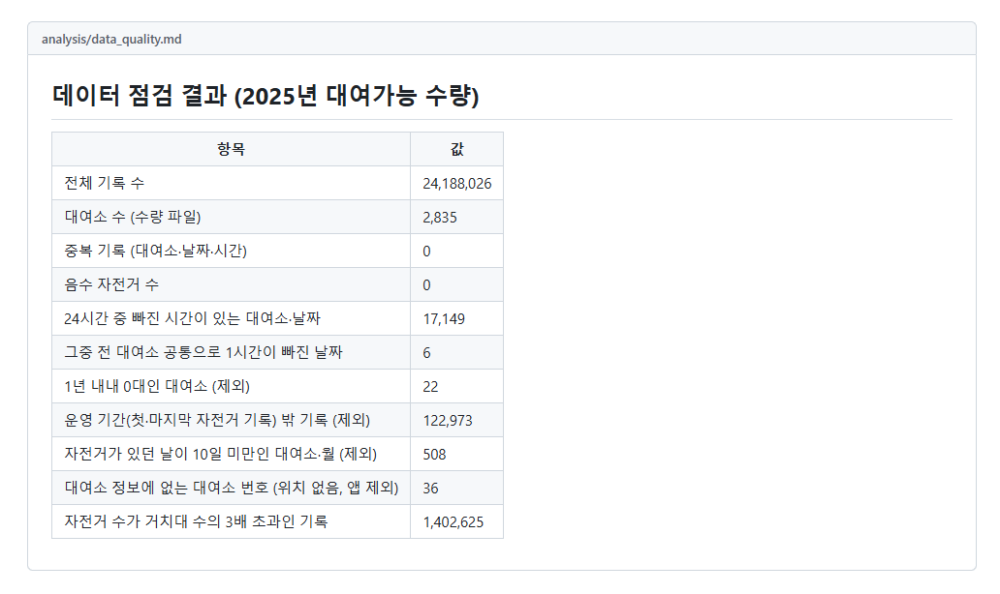
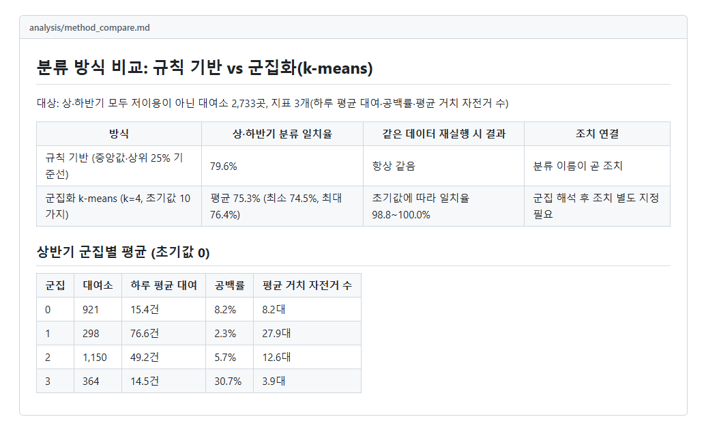
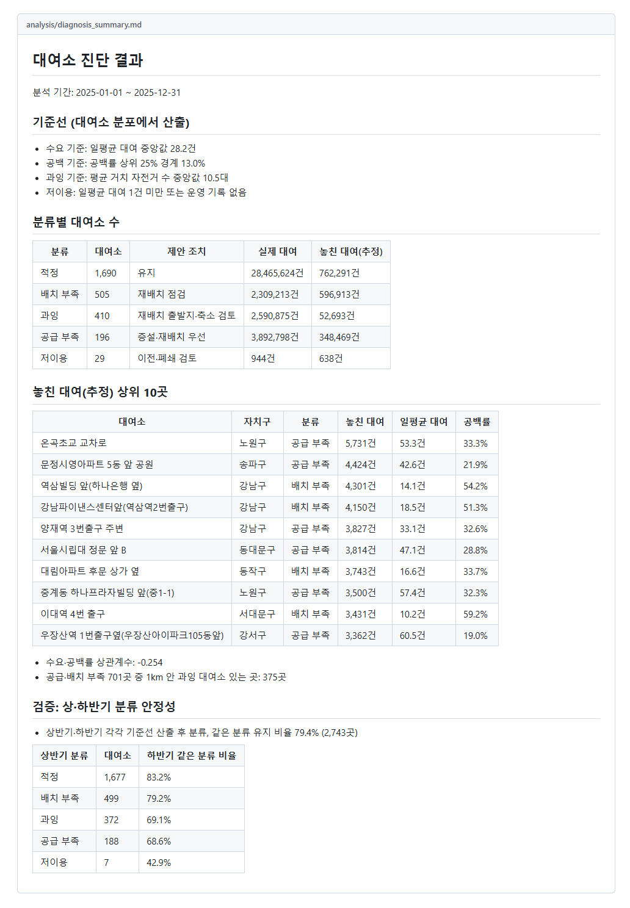
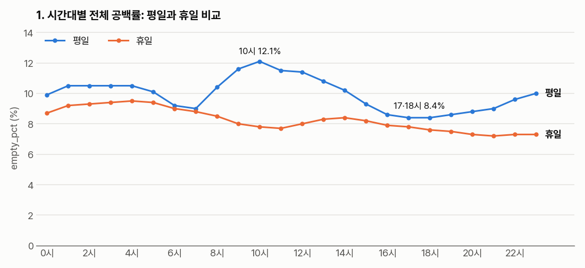
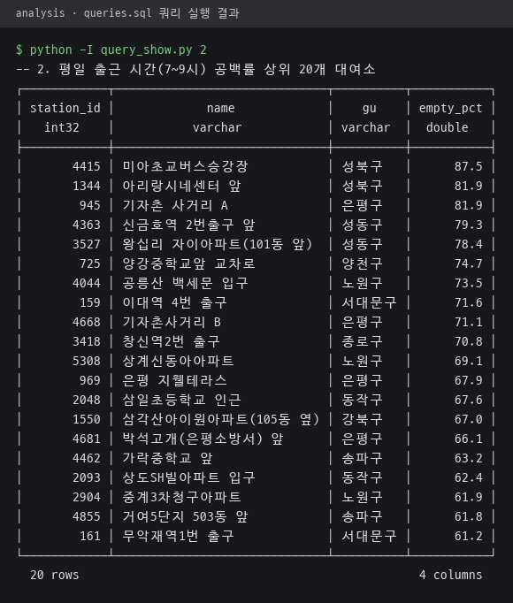
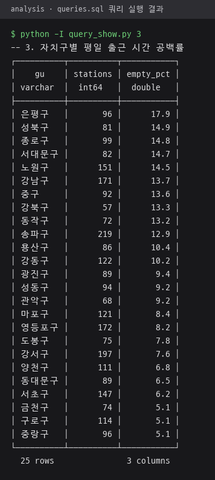
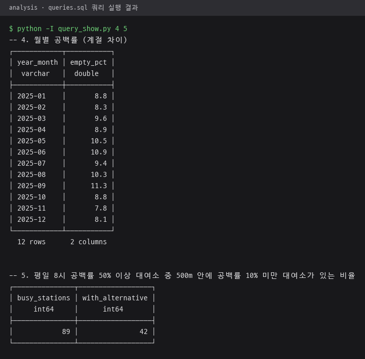
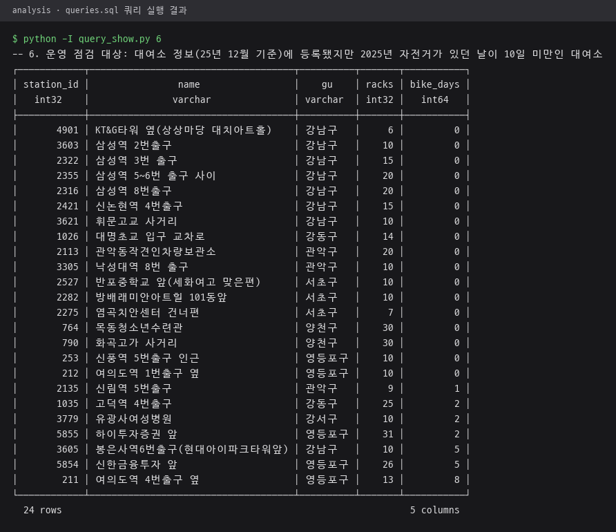

# analysis · 점검·진단·분석 결과 문서

데이터 점검, 대여소 진단, 분류 방식 비교, 분석 쿼리 결과를 정리한 문서와 분석 SQL.
대부분 [scripts](../scripts/README.md)의 스크립트가 실행할 때마다 다시 생성. 전체 흐름은 [저장소 README](../README.md#전체-구조) 참고.

## 파일 구성

| 파일 | 내용 | 생성 |
|---|---|---|
| `data_quality.md` | 2025년 대여 가능 수량 점검 결과. 전체 기록 수, 중복·음수, 빠진 시간, 제외 대여소·기록 수 | `build_metrics.py` |
| `diagnosis_summary.md` | 기준선, 분류별 대여소 수, 놓친 대여 추정 상위 10곳, 상·하반기 분류 유지 비율 | `build_diagnosis.py` |
| `method_compare.md` | 규칙 기반 분류와 k-means 군집화의 상·하반기 일치율, 재실행 결과, 군집별 평균 비교 | `compare_methods.py` |
| `queries.sql` | DuckDB 분석 쿼리 6개. 시간대·대여소·자치구·월별 비율, 500m 안 대체 대여소 비율, 운영 점검 대상 | 직접 작성 |
| `query_results.md` | `queries.sql` 쿼리별 결과 표와 소요 시간 | `run_queries.py` |
| `db_compare.md` | 같은 데이터·같은 단계의 SQLite·DuckDB 적재·집계 시간과 파일 크기 비교, DuckDB 선택 근거 | 측정 기록, 생성 스크립트 없음 |

## 생성 문서 화면

저장소 사본에서 `load.py`부터 `run_queries.py`까지 다시 실행해 만든 결과 문서를 GitHub 문서 모양으로 띄운 화면.

| `data_quality.md` · 2025년 대여 가능 수량 점검 11개 항목 | `method_compare.md` · 상·하반기 일치율과 상반기 군집별 평균 |
|---|---|
|  |  |

`diagnosis_summary.md` 화면. 기준선 3개, 분류별 대여소 수와 실제·놓친 대여, 놓친 대여 추정 상위 10곳, 상·하반기 분류 유지 비율 79.4%.



## 분석 쿼리 실행 결과

`queries.sql`을 `run_queries.py`와 같은 방식으로 `;` 단위로 나눠 DuckDB에서 실행한 결과. 1번은 48행이라 결과 값을 그래프로 표시, 나머지는 DuckDB 표 출력 그대로.

1번 시간대별 공백률 결과 그래프. 평일 10시 12.1%로 가장 높고 17·18시 8.4%로 가장 낮음, 휴일은 하루 내내 7.2~9.5%.



| 2번 · 평일 7~9시 공백률 상위 20개 대여소 | 3번 · 자치구별 평일 7~9시 공백률 |
|---|---|
|  |  |

| 4·5번 · 월별 공백률, 500m 안 대체 대여소 비율 | 6번 · 자전거가 있던 날 10일 미만 운영 점검 대상 |
|---|---|
|  |  |

5번 결과는 평일 8시 공백률 50% 이상 대여소 89곳 중 500m 안에 공백률 10% 미만 대여소가 있는 곳 42곳.

## 다시 만들기

DuckDB 파일 `data/ddareungi.duckdb`가 있는 상태에서 실행. 앞 단계 전체 명령은 [저장소 README 실행 방법](../README.md#실행-방법) 참고.

```
.venv\Scripts\python -I scripts\build_metrics.py     # data_quality.md
.venv\Scripts\python -I scripts\build_diagnosis.py   # diagnosis_summary.md
.venv\Scripts\python -I scripts\compare_methods.py   # method_compare.md
.venv\Scripts\python -I scripts\run_queries.py       # query_results.md
```

`run_queries.py`는 `queries.sql`을 `;` 단위로 나누고 `-- 번호.` 주석을 쿼리 제목으로 사용. 쿼리를 추가할 때도 같은 형식으로 작성해야 결과 문서에 기록.

## 표기 대응

결과 문서와 SQL은 스크립트 안의 분류 이름과 작업 중 쓰던 지표 이름 사용. 저장소 README·Flutter 앱·Power BI 화면 이름과의 대응 정리.

| 결과 문서·SQL 표기 | 저장소 README·앱 표기 |
|---|---|
| 공백률 | 전량 대여 비율 |
| 공급 부족 | 대여소 증설 검토 |
| 배치 부족 | 자전거 배치 확대 |
| 과잉 | 자전거 배치 축소 |
| 저이용 | 대여소 이전·폐쇄 검토 |
| 적정 | 현 상태 유지 |

`diagnosis_summary.md`의 제안 조치 열은 `build_diagnosis.py` 내부 문구. 최종 조치 이름은 위 표 오른쪽 열 기준.
