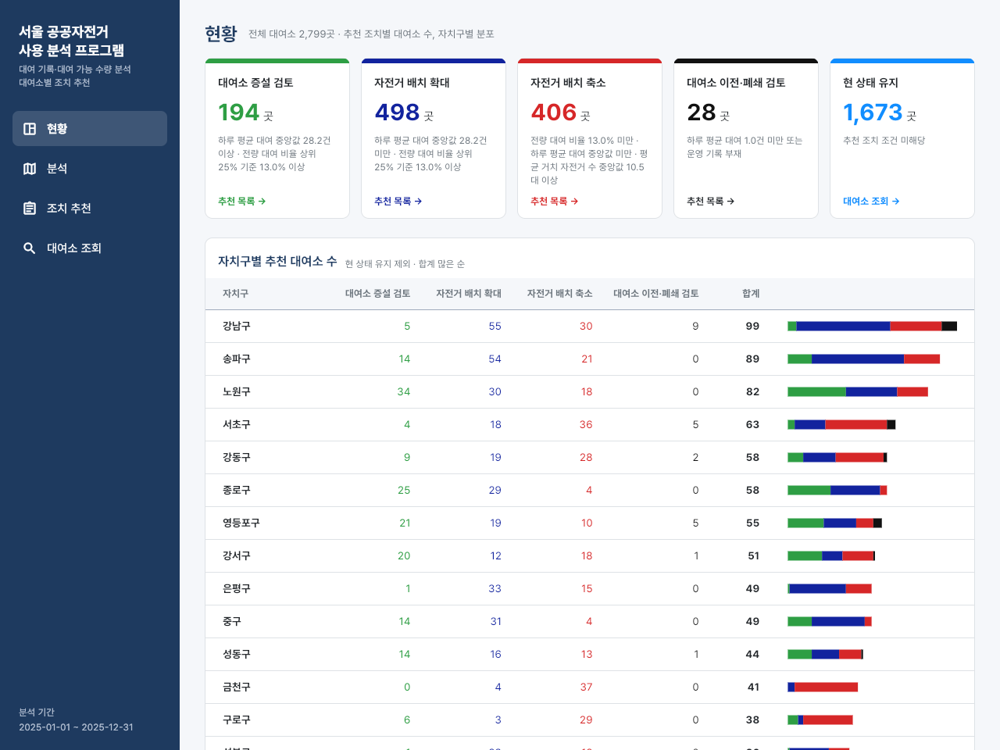
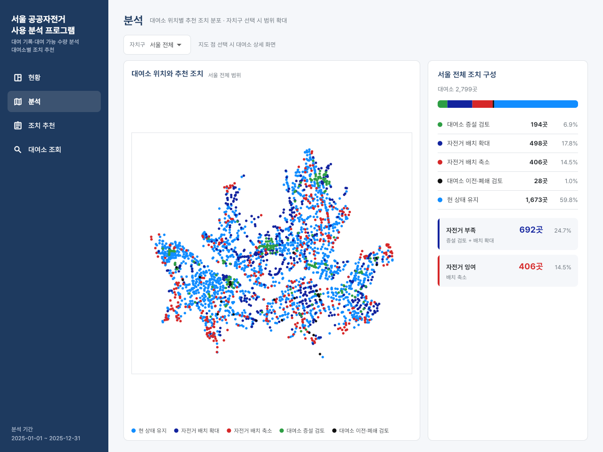
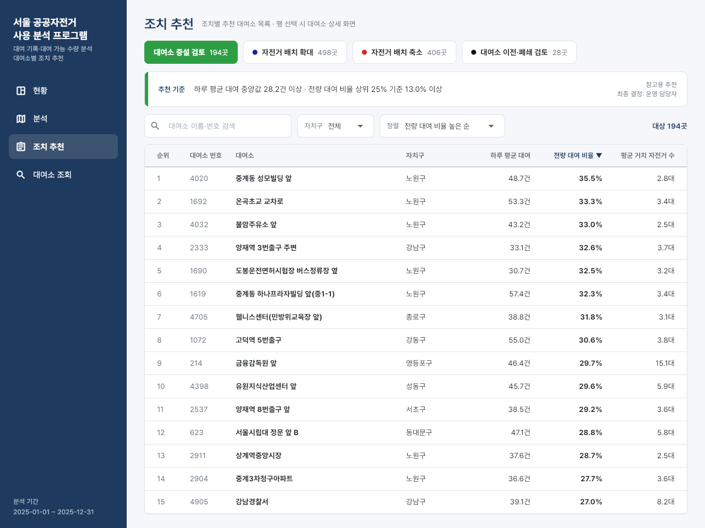
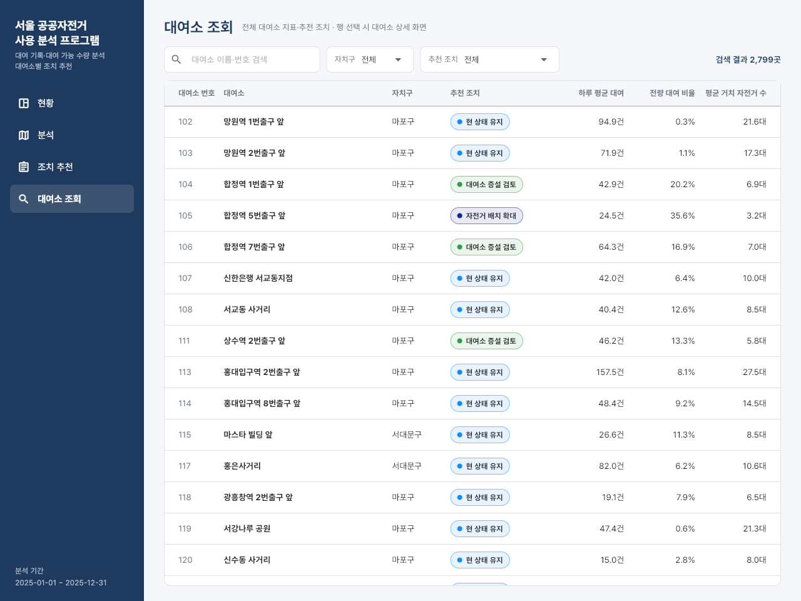
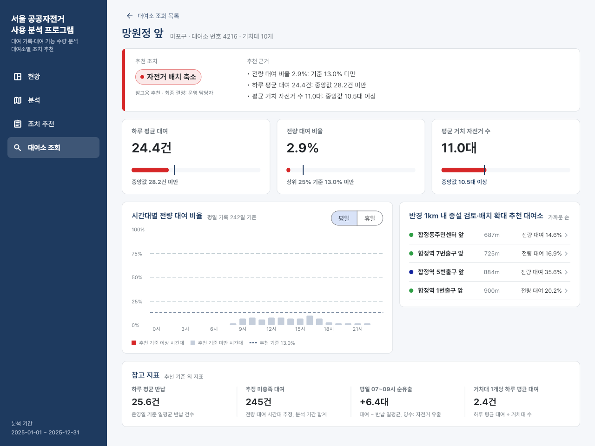

# 서울 공공자전거 사용 분석 프로그램 (Flutter)

대여 기록·대여 가능 수량 분석 기반 대여소별 조치 추천 앱. 집계 결과(`assets/*.json`)는 `../scripts/build_metrics.py`와 `../scripts/build_diagnosis.py`가 만든다.

- Flutter 3.47.7 (Dart 3.13.5) 고정
- 화면 구성과 실행 방법은 저장소 최상위 `README.md`의 "앱"과 "실행 방법" 절 참고

## 실행 화면

Flutter 웹 빌드를 Chrome 1280×960 창에서 실행해 메뉴마다 찍은 화면. 데이터는 `assets/*.json` 그대로 사용.

| 현황 · 조치별 대여소 수와 추천 기준, 자치구별 추천 대여소 수 | 분석 · 서울 전체 대여소 위치별 추천 조치와 조치 구성 비율 |
|---|---|
|  |  |

| 조치 추천 · 대여소 증설 검토 194곳, 전량 대여 비율 높은 순 | 대여소 조회 · 전체 2,799곳 표 |
|---|---|
|  |  |

대여소 조회에서 `망원정`을 검색해 연 대여소 상세 화면. 자전거 배치 축소 추천 근거 3가지, 지표 3개의 기준선 비교, 평일 시간대별 전량 대여 비율, 반경 1km 안 증설 검토·배치 확대 대상 4곳 표시.

