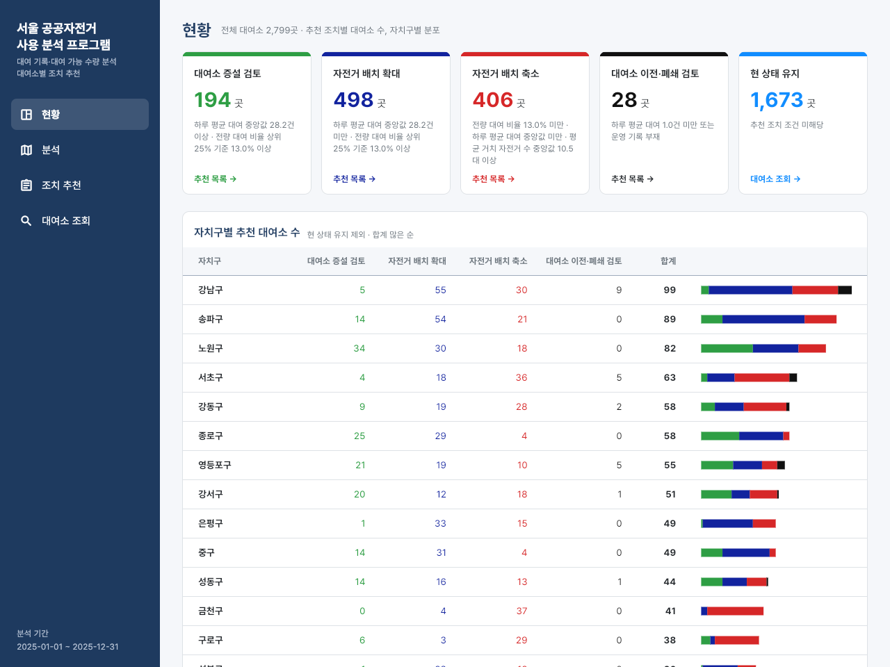
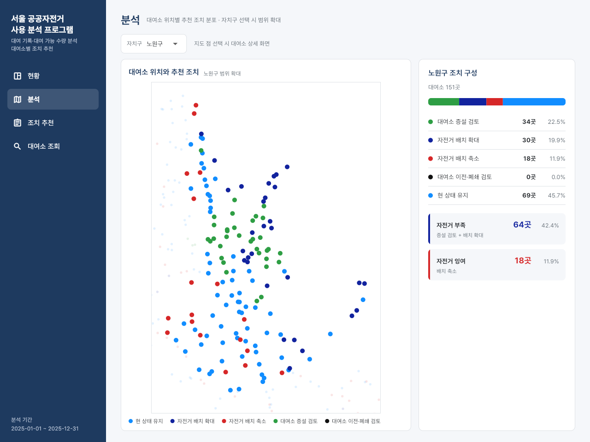
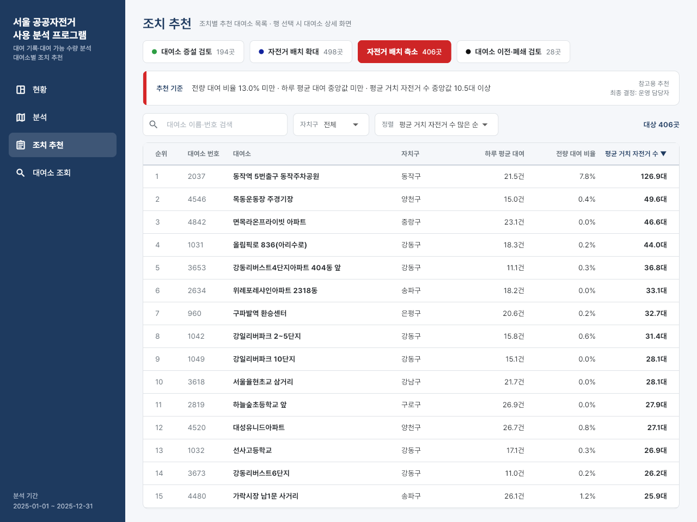
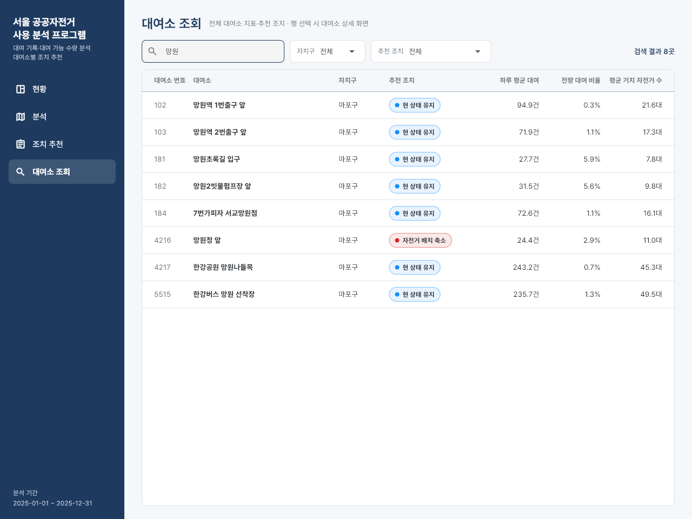
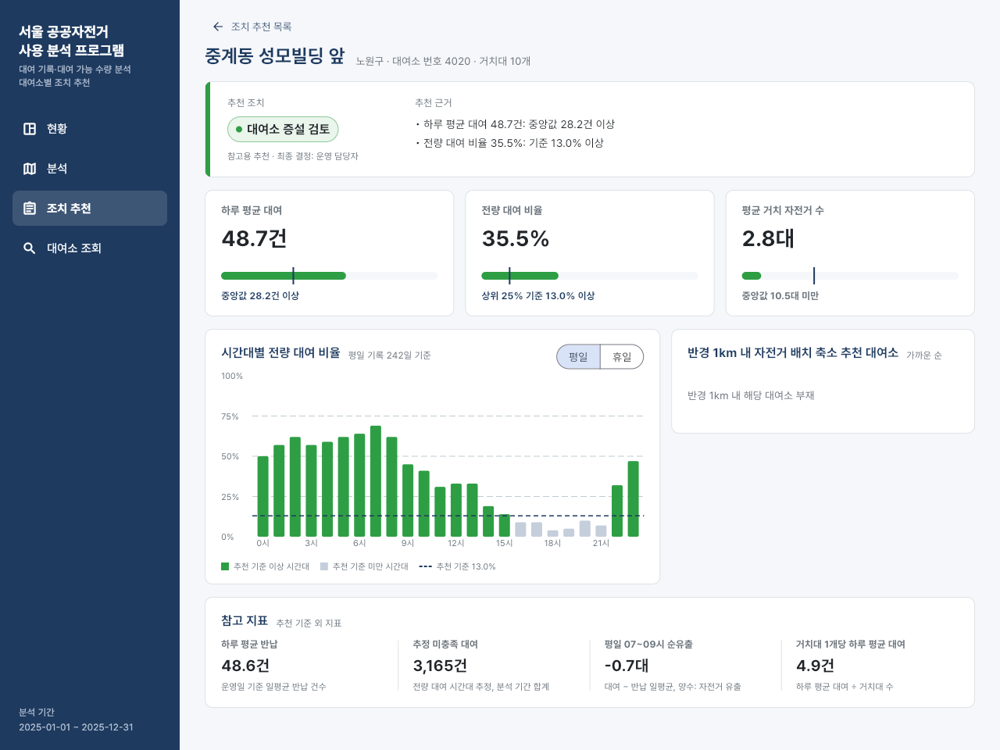
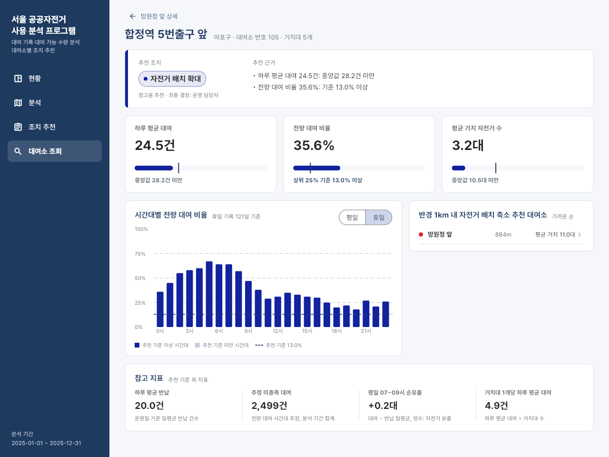

# lib · Flutter 분석 프로그램 소스

운영 담당자가 대여소별 추천 조치와 근거를 확인하는 Flutter 앱의 Dart 코드.
메뉴별 화면 설명은 [저장소 README 5장](../../README.md#5-flutter-분석-프로그램), 버전 고정 내용은 [앱 README](../README.md) 참고.

## 구성

화면 코드와 판정 코드 분리. 화면은 `*_page.dart`·`station_detail.dart`, 데이터 읽기와 판정은 `data.dart`·`diagnosis.dart`, 공통 색과 위젯은 `style.dart`에 위치.

| 파일 | 역할 |
|---|---|
| `main.dart` | 앱 시작점. `AppData.load()`·`DiagnosisData.load()` 완료 후 `Shell` 표시, 로딩 실패 시 오류 문구 표시 |
| `shell.dart` | 화면 틀. 왼쪽 메뉴 4개와 오른쪽 기능 화면, 대여소 상세 이동 기록으로 뒤로 가기 처리 |
| `data.dart` | `assets/stations.json`·`empty_rate.json` 읽기. 대여소 위치·거치대 수, 평일·휴일 24시간 전량 대여 비율 |
| `diagnosis.dart` | `assets/diagnosis.json` 읽기. 추천 조치 `Act`, 정렬 기준 `SortKey`, 기준선, 추천 기준·근거 문장, 목록 필터·정렬, 연결 대여소, 근사 거리 `meters()` |
| `overview_page.dart` | 현황 메뉴. 조치별 대여소 수 카드와 추천 기준, 자치구별 추천 대여소 수 막대 |
| `analysis_page.dart` | 분석 메뉴. 대여소 위치별 추천 조치 산점도, 자치구 선택 시 범위 확대와 조치 구성 비율 |
| `recommend_page.dart` | 조치 추천 메뉴. 조치별 탭, 추천 기준 문장, 검색·자치구·정렬 선택 |
| `station_list_page.dart` | 대여소 조회 메뉴. 전체 대여소 검색, 자치구·추천 조치 선택. 조치 추천 메뉴와 함께 쓰는 대여소 표 `StationTable` 포함 |
| `station_detail.dart` | 대여소 상세. 추천 조치와 근거, 지표 3개와 기준선 비교, 평일·휴일 시간대별 전량 대여 비율 막대그래프, 반경 1km 연결 대여소, 참고 지표 |
| `style.dart` | 공통 색 상수와 위젯. `PageHeader`·`SectionTitle`·`ActionBadge`·`Panel`·`TableRowCells`·`Picker`·`SearchBox`, 숫자 표기 함수 `comma()`·`n1()` |

## 화면 파일별 실행 화면

Flutter 웹 빌드를 Chrome 1280×960 창에서 실행해 화면 파일마다 찍은 결과. 왼쪽 메뉴는 `shell.dart`, 오른쪽이 각 화면 파일 출력.

| `overview_page.dart` · 조치별 카드와 자치구별 추천 대여소 수 막대 | `analysis_page.dart` · 자치구 `노원구` 선택 시 범위 확대와 조치 구성 비율 |
|---|---|
|  |  |

| `recommend_page.dart` · 자전거 배치 축소 탭, 평균 거치 자전거 수 많은 순 | `station_list_page.dart` · 검색어 `망원` 입력 결과 8곳 |
|---|---|
|  |  |

| `station_detail.dart` · 대여소 증설 검토 대상, 반경 1km 안 배치 축소 대상 없음 | `station_detail.dart` · 연결 대여소에서 이동한 배치 확대 대상, 휴일 막대그래프 |
|---|---|
|  |  |

오른쪽 상세 화면은 `망원정 앞` 상세에서 연결 대여소 `합정역 5번출구 앞`을 눌러 이동한 뒤 `휴일`로 바꾼 결과. 뒤로 가기 문구가 `망원정 앞 상세`로 바뀌어 `shell.dart`의 이동 기록 처리 확인 가능.

## 데이터 흐름

1. `scripts/build_metrics.py`·`build_diagnosis.py`가 `app/assets/`에 JSON 3개 생성
2. `data.dart`·`diagnosis.dart`가 앱 시작 시 JSON을 읽어 `AppData`·`DiagnosisData` 구성
3. 추천 조치 근거·기준 문장·목록 정렬·연결 대여소는 `DiagnosisData` 함수에서 계산, 각 화면은 그 결과 표시

- 조치 색은 `diagnosis.dart`의 `Act`에서 정의, Power BI 테마와 같은 색
- 그래프는 `fl_chart` 사용, 산점도는 분석 메뉴, 막대그래프는 대여소 상세
- 판정 함수 단위 시험은 [test](../test/README.md)

## 실행

```
cd app
flutter pub get
flutter test
flutter run -d chrome
```
