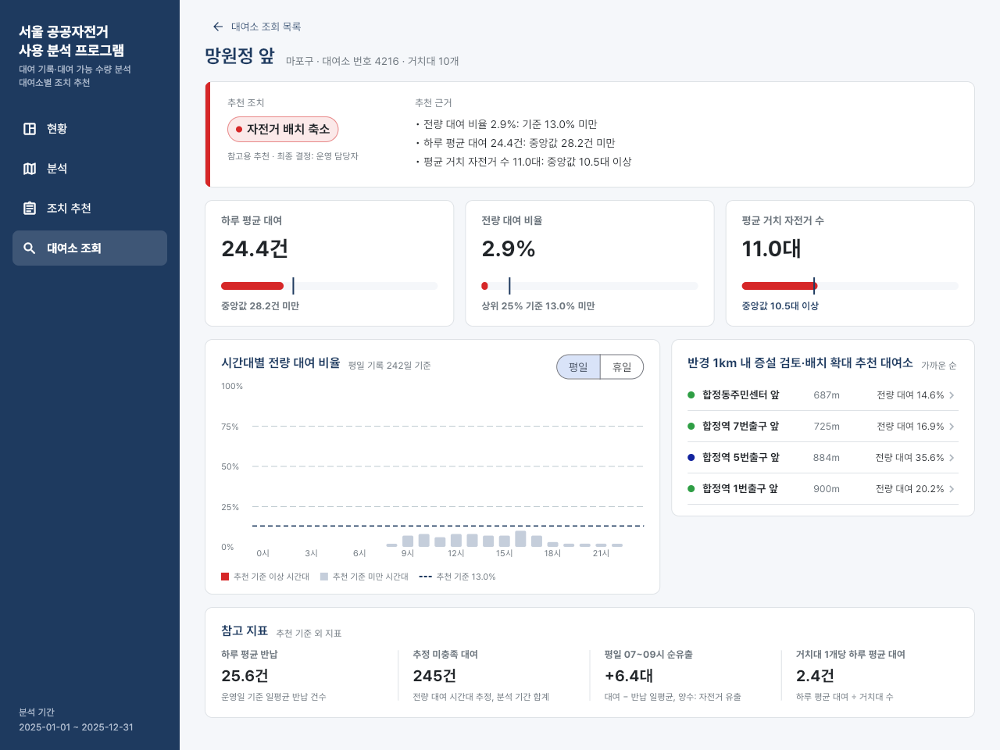

# test · 진단 로직 단위 시험

`lib/diagnosis.dart`의 판정 함수를 화면 없이 검증하는 단위 시험.
앱 소스 구성은 [lib README](../lib/README.md), 프로젝트 전체 설명은 [저장소 README](../../README.md#5-flutter-분석-프로그램) 참고.

## 파일

| 파일 | 역할 |
|---|---|
| `diagnosis_test.dart` | 가상 대여소와 고정 기준선으로 `DiagnosisData`를 직접 만들어 시험 6개 실행. JSON 파일 불필요 |

고정 기준선: 하루 평균 대여 중앙값 10건, 전량 대여 비율 상위 25% 경계 25%, 평균 거치 자전거 수 중앙값 5대.

## 시험 항목

| 시험 | 확인 내용 |
|---|---|
| 근사 거리 | `meters()`로 계산한 망원역 1번·2번 출구 대여소 사이 거리 약 80m |
| 검색 | 띄어쓰기 무시 이름 검색, 대여소 번호 일치 검색 |
| 목록 정렬 | 조치·자치구 필터 후 정렬 기준 순서, 같은 값이면 대여소 번호 순 |
| 추천 근거 | 기준선 이상·미만 문구, 기준선과 같은 값은 이상 처리, 운영 기록 없는 대여소 문구 |
| 추천 기준 문장 | 조치별 기준 문장에 기준선 값 표시 |
| 연결 대여소 | 증설·확대 대상은 저장된 상대 순서 유지, 배치 축소 대상은 가까운 순 역방향 연결, 없는 대여소 번호 제외 |

## 앱 화면에서 본 판정 결과

`flutter test` 실행 화면이 아닌, 시험 대상 함수의 결과가 실제 앱에 나타난 모습. Flutter 웹 빌드를 Chrome에서 실행해 찍은 화면.

검색 시험 항목 대응. 띄어쓰기 없이 `망원역1번출구` 입력 시 `망원역 1번출구 앞` 검색 결과.


대여소 번호 `4216` 입력 시 번호가 일치하는 `망원정 앞` 한 곳 검색 결과.


연결 대여소 시험 항목 대응. 자전거 배치 축소 대상 `망원정 앞`에 이 대여소를 연결 대상으로 가진 증설 검토·배치 확대 대상 4곳이 687m, 725m, 884m, 900m 가까운 순으로 표시된 화면.



## 실행

```
cd app
flutter test
```
