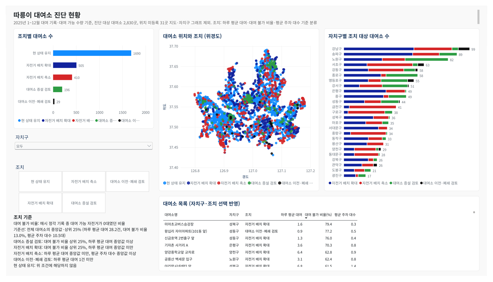
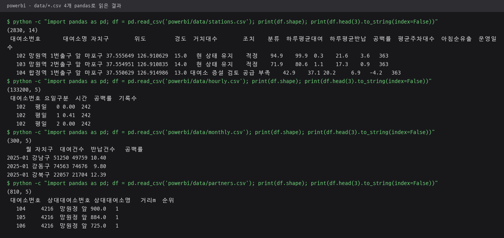
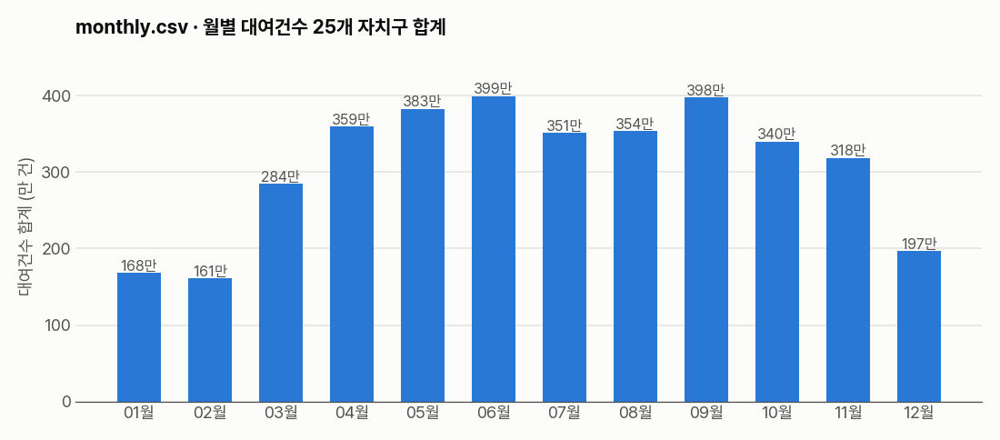
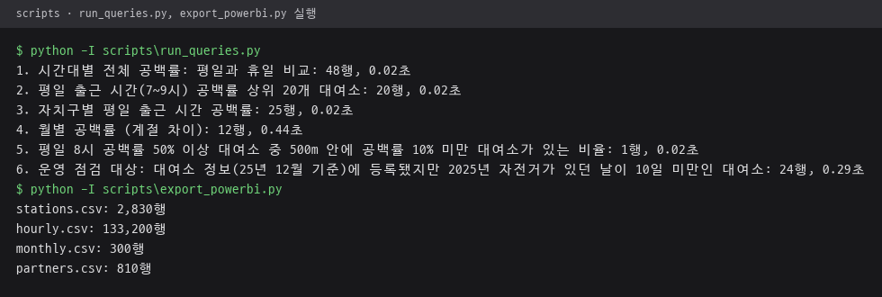

# powerbi · 현황 대시보드

진단 결과 CSV를 불러와 조치별 대여소 현황을 보여 주는 Power BI 보고서와 테마, 데이터 CSV.
화면 구성과 DAX 측정값은 [저장소 README 4장](../README.md#4-power-bi-현황-대시보드) 참고.

## 파일 구성

| 파일 | 내용 |
|---|---|
| `따릉이_대여소_진단.pbix` | Power BI Desktop 보고서. 조치별 대여소 수, 위경도 산점도, 자치구별 조치 대상, 대여소 목록 |
| `theme_ddareungi.json` | 보고서 테마. Flutter 앱과 같은 조치별 색, 남색 제목, Pretendard 글꼴 |
| `data/stations.csv` | 대여소별 진단 결과. 위치·자치구·거치대 수, 조치·분류, 하루 평균 대여·반납, 지표, 운영일수 |
| `data/hourly.csv` | 대여소별 평일·휴일 시간대 비율과 기록 수 |
| `data/monthly.csv` | 월·자치구별 대여 건수, 반납 건수, 비율 |
| `data/partners.csv` | 증설·배치 확대 대상별 반경 1km 안 배치 축소 대상, 거리순 최대 3곳 |

- CSV 4개는 `scripts/export_powerbi.py`가 DuckDB에서 내보낸 결과. UTF-8, 한글 칼럼명, 파일명은 영문
- `stations.csv`에는 위치 정보가 없는 대여소도 포함, 자치구를 `위치 미등록`으로 표시
- 칼럼 `공백률`은 전량 대여 비율, `평균주차대수`는 평균 거치 자전거 수, `분류`는 스크립트 내부 분류 이름. 대응표는 [analysis README](../analysis/README.md#표기-대응) 참고

## 보고서 화면

Power BI Desktop에서 `따릉이_대여소_진단.pbix`를 연 현황 대시보드. 조치별 대여소 수, 위경도 산점도, 자치구별 조치 대상, 대여소 목록.



## 데이터 CSV 확인

보고서가 불러오는 CSV 4개를 pandas로 읽어 행·칼럼 수와 앞 3행을 출력한 결과. `stations.csv` 2,830행, `hourly.csv` 133,200행, `monthly.csv` 300행, `partners.csv` 810행.



`monthly.csv`의 대여건수를 월별로 합쳐 matplotlib으로 그린 그래프. Power BI 보고서 화면이 아닌 CSV 값 확인용 그래프.



## 갱신 방법

```
.venv\Scripts\python -I scripts\build_diagnosis.py
.venv\Scripts\python -I scripts\export_powerbi.py
```

CSV를 다시 만든 뒤 Power BI Desktop에서 `따릉이_대여소_진단.pbix`를 열고 새로 고침.

`export_powerbi.py` 실행 결과. 아래쪽 4줄이 CSV별 행 수.


