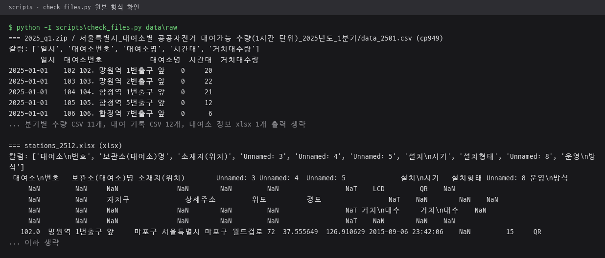
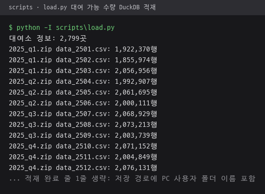
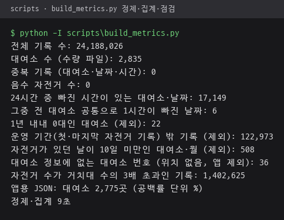
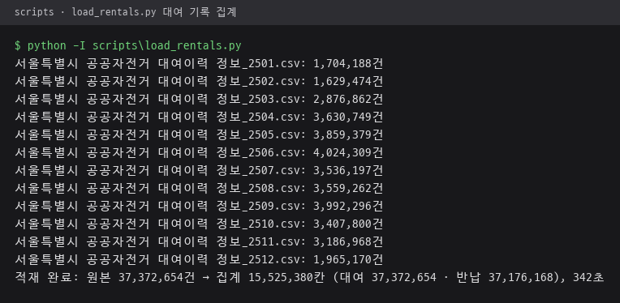
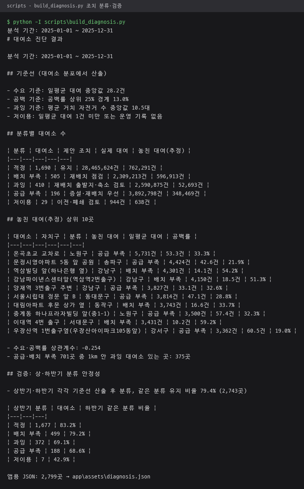
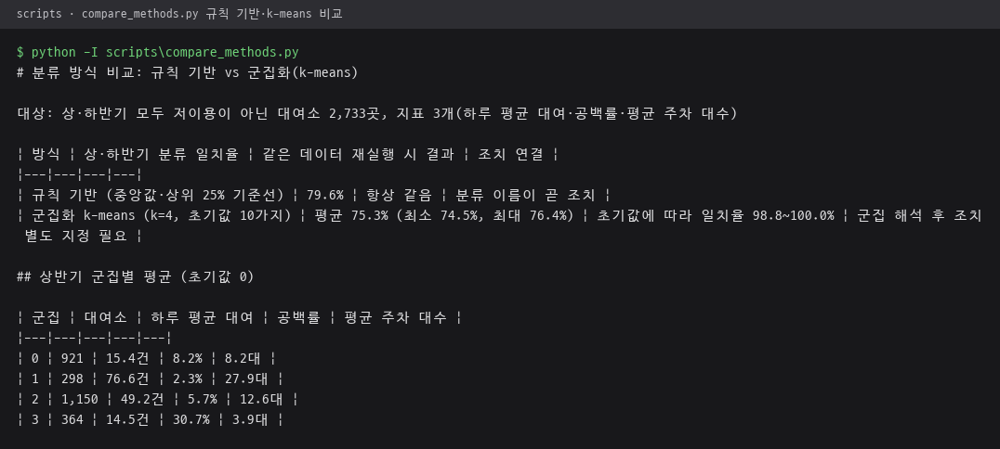
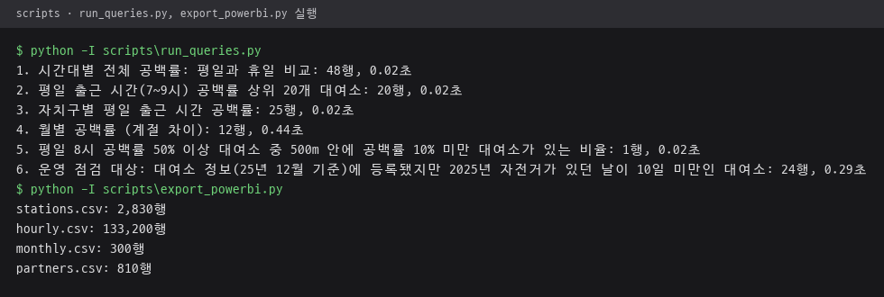

# scripts · 수집·적재·진단·내보내기 스크립트

서울 열린데이터광장 원본을 내려받아 DuckDB 파일 `data/ddareungi.duckdb`에 적재하고, 진단 결과를 분석 문서·앱용 JSON·Power BI용 CSV로 내보내는 Python 스크립트 모음.
전체 흐름과 지표·조치 정의는 [저장소 README](../README.md#전체-구조) 참고.

## 파일 구성

| 순서 | 파일 | 역할 | 결과물 |
|---|---|---|---|
| 1 | `fetch.py` | 데이터셋 3개의 사이트 파일 목록과 보유 파일 대조, 없는 파일만 내려받기. `--since`로 시작 연도 지정, 기본 2025 | `data/raw/` |
| - | `check_files.py` | 내려받은 zip·CSV·xlsx의 인코딩·칼럼·앞 5행 출력. UTF-8 실패 시 CP949로 재시도 | 화면 출력 |
| 2 | `load.py` | 대여소 정보 xlsx와 분기별 대여 가능 수량 zip 적재, 원본 칼럼 `거치대수량`을 `bikes`로 변경. 실행마다 DB 파일 새로 생성 | `stations`·`station_names`·`availability` 표 |
| 3 | `build_metrics.py` | 운영 기간·운영 중인 달 판별, 평일·휴일 구분, 대여소·시간대별 전량 대여 비율 집계, 데이터 점검 | `station_span`·`station_month`·`calendar`·`empty_rate` 표, `analysis/data_quality.md`, `app/assets/stations.json`·`empty_rate.json` |
| 4 | `load_rentals.py` | 연 단위 대여 기록을 100만 행씩 읽어 대여소·날짜·시간대별 대여·반납 수로 집계, 2025년 밖 날짜 제외 | `flows` 표 |
| 5 | `build_diagnosis.py` | 지표 3개 산출, 기준선 계산, 조치 분류, 상·하반기 분류 검증, 반경 1km 연결 대여소 | `diagnosis`·`diag_h1`·`diag_h2`·`partners` 표, `analysis/diagnosis_summary.md`, `app/assets/diagnosis.json` |
| 6 | `compare_methods.py` | 같은 지표 3개로 규칙 기반 분류와 numpy k-means 비교, 초기값 10가지 반복 | `analysis/method_compare.md` |
| 7 | `run_queries.py` | `analysis/queries.sql`을 쿼리 단위로 나눠 실행, 결과 표와 소요 시간 기록 | `analysis/query_results.md` |
| 8 | `export_powerbi.py` | 대여소·시간대·월별·연결 대여소 CSV 4개 내보내기, UTF-8과 한글 칼럼명 | `powerbi/data/*.csv` |

- `check_files.py`를 뺀 모든 스크립트는 저장소 최상위 기준으로 경로 계산, 어느 폴더에서 실행해도 같은 위치에 저장. `check_files.py`의 폴더 인자는 실행 위치 기준
- 2번부터 8번까지 같은 DuckDB 파일 공유, 앞 단계 표가 있어야 다음 단계 실행 가능
- 원본 데이터와 DB 파일은 저장소 제외, 결과 문서·JSON·CSV는 저장소 포함

## 실행 순서

```
.venv\Scripts\python -I scripts\fetch.py
.venv\Scripts\python -I scripts\check_files.py data\raw   # 선택: 원본 형식 확인
.venv\Scripts\python -I scripts\load.py
.venv\Scripts\python -I scripts\build_metrics.py
.venv\Scripts\python -I scripts\load_rentals.py
.venv\Scripts\python -I scripts\build_diagnosis.py
.venv\Scripts\python -I scripts\compare_methods.py
.venv\Scripts\python -I scripts\run_queries.py
.venv\Scripts\python -I scripts\export_powerbi.py
```

가상환경 준비와 버전은 [저장소 README 실행 방법](../README.md#실행-방법) 참고.

`load.py`는 기존 DB 파일을 지우고 다시 만들기 때문에, 실행 후에는 3번 이후 단계도 다시 실행.

## 실행 결과

미리 받아 둔 `data/raw/` 원본으로 `fetch.py`를 뺀 위 순서를 저장소 사본에서 차례로 실행한 출력. Python 3.10, `requirements.txt` 버전 그대로 설치. 다시 만든 앱용 JSON 3개와 Power BI용 CSV 4개는 저장소 파일과 같은 내용.

`check_files.py data\raw` 출력 앞부분. 대여 가능 수량 CSV의 CP949 인코딩과 `거치대수량` 칼럼, 대여소 정보 xlsx의 병합 머리글 5줄 확인.



| 2 `load.py` · 대여소 정보와 월별 수량 CSV 12개 적재 | 3 `build_metrics.py` · 데이터 점검 항목과 앱용 JSON |
|---|---|
|  |  |

`load.py`의 마지막 적재 완료 줄은 DB 저장 경로에 PC 사용자 폴더 이름이 들어 있어 사진에서 제외.

4 `load_rentals.py` 출력. 월별 대여 기록 CSV 12개, 원본 37,372,654건을 대여소·날짜·시간대 15,525,380칸으로 집계.



5 `build_diagnosis.py` 출력. 기준선, 분류별 대여소 수, 놓친 대여 추정 상위 10곳, 상·하반기 분류 유지 비율을 출력하고 같은 내용을 `analysis/diagnosis_summary.md`에 저장.



| 6 `compare_methods.py` · 규칙 기반 79.6%, k-means 평균 75.3% | 7·8 `run_queries.py`·`export_powerbi.py` · 쿼리 6개 소요 시간, CSV 4개 행 수 |
|---|---|
|  |  |

## 표기

스크립트 안의 분류 이름과 일부 출력 문구는 작업 중 쓰던 이름 유지. `공백률`은 전량 대여 비율, `공급 부족`·`배치 부족`·`과잉`·`저이용`·`적정`은 각각 대여소 증설 검토·자전거 배치 확대·자전거 배치 축소·대여소 이전·폐쇄 검토·현 상태 유지에 대응. 전체 대응표는 [analysis README](../analysis/README.md#표기-대응) 참고.
